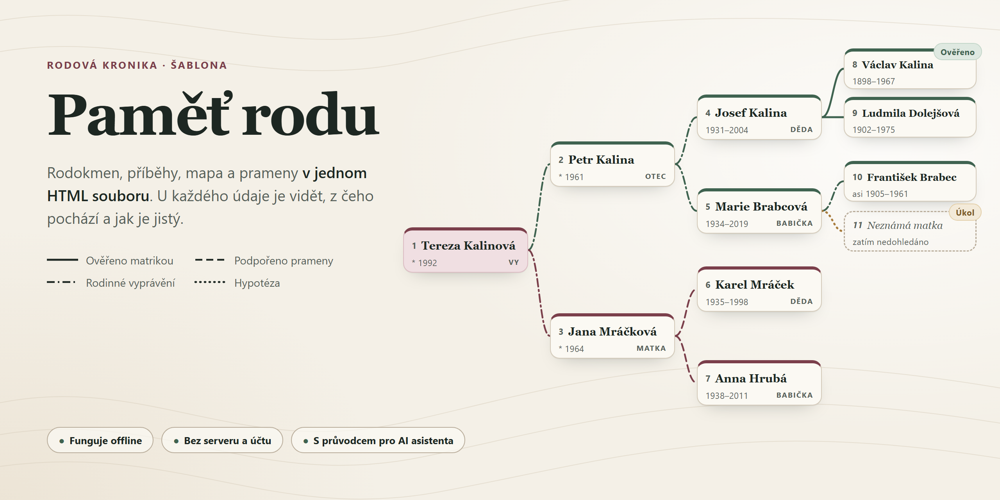

# Paměť rodu

Rodová kronika v **jednom HTML souboru**, který otevřeš v prohlížeči i bez internetu. U každého údaje je vidět, z jakého pramene pochází a nakolik je jistý.



## Hlavní přednosti

- **Jeden soubor, žádná instalace pro rodinu.** Kroniku pošleš e-mailem nebo dáš na úložiště a otevře se v počítači i v telefonu. Nic se neodesílá na internet; mapa i knihovny jsou uvnitř souboru.
- **Míra jistoty u každého údaje.** Ověřeno z matriky, podpořeno slabším pramenem, rodinné vyprávění, nebo hypotéza. Rozpory se nemažou, stojí vedle sebe.
- **Rodokmen, příběhy, mapa a čas.** Vývod předků s čísly jako v knize, celý rodokmen, životní příběhy psané z dat, mapa stěhování rodu a časová osa s dějinami, které lidé zažili.
- **Hlasy pamětníků.** Rozhovory se přepíší lokálně (Whisper) a krátké úryvky se přehrají přímo u osob.
- **Pro každého čtenáře jiné vydání.** Rodinné vydání bez pracovních poznámek, badatelské vydání s nástroji, lehké vydání pro e-mail, **tištěná kniha** pro prarodiče bez počítače, audiokniha a papírový dotazník.
- **Zaheslované sdílení.** Kronika se šifruje v počítači (AES-GCM) a může běžet i jako stránka na GitHub Pages zdarma.
- **Rodina přispívá.** U osob a fotek je formulář, který připraví e-mail s opravou nebo vzpomínkou; z došlých e-mailů vznikne dávka změn ke kontrole.
- **Badatelna.** Výzkumná fronta s matrikami, kde hledat, kontrola věrohodnosti dat, přepis matričního zápisu, editor, DNA a GEDCOM 7 pro výměnu s MyHeritage, FamilySearch nebo Gramps.
- **Stavěné pro práci s AI asistentem.** Pravidla a dovednosti pro Claude Code nebo Codex vedou asistenta k pramenům, ne k domněnkám.
- **Bez závislostí.** Stačí Node.js 20+, žádné `npm install`.

## Co to v praxi dokázalo

Šablona vznikla z jedné skutečné rodinné kroniky. Za šest týdnů práce s AI asistentem v ní vzniklo:

- **353 osob** a **485 vazeb**, z toho **170 přímých předků v 11 generacích**; nejstarší předek se narodil v roce **1673**,
- **308 pramenů**, z toho **149 matričních zápisů** čtených v digitalizovaných matrikách,
- **257 tvrzení** s mírou jistoty, **110** z nich ověřených vlastním primárním zápisem,
- **46 míst** na mapě a **140 událostí** na časové ose,
- přepsaný rozhovor s dědečkem a **22 úryvků** jeho vyprávění přímo u osob,
- **tištěná kniha** pro dědečka, který nikdy nepoužil počítač, a zaheslovaná kronika na webu pro celou rodinu.

Data té kroniky zůstávají soukromá; šablona obsahuje jen kód a vymyšlený ukázkový rod.

## Rychlý start

**S AI asistentem (doporučeno):** v [Claude Code](https://claude.com/claude-code) otevři složku, kam chceš kroniku uložit, a napiš:

> Chci si založit rodovou kroniku podle tohoto projektu: *odkaz na tento repozitář*

**Ručně:** stáhni projekt (**Code › Download ZIP**), v jeho složce otevři příkazový řádek a spusť:

```bash
node scripts/build.mjs
```

Otevři `dist/rodova-kronika.html`. Uvidíš **vymyšlený ukázkový rod Kalinů z Lipové Lhoty**. Vlastní kroniku založíš příkazem:

```bash
node scripts/init.mjs
```

Všechno ostatní (vydání, kniha, rozhovory, sdílení, Badatelna) popisuje [podrobný návod](docs/navod.md).

<details>
<summary><strong>Pokyny pro AI asistenta (Claude Code, Codex a další)</strong></summary>

Pokud tě uživatel poslal na tento repozitář, aby si založil vlastní kroniku, postupuj takto. Mluv česky, krátce a srozumitelně – uživatel nemusí být programátor. Před každým krokem, který něco instaluje nebo mění mimo složku projektu, se zeptej.

1. **Kam:** zeptej se, kam projekt uložit (výchozí: podsložka `rodova-kronika` v aktuální složce). Naklonuj repozitář (`git clone <odkaz> rodova-kronika`); když git chybí, stáhni ZIP (`<odkaz>/archive/refs/heads/main.zip`) a rozbal ho.
2. **Odpojení od šablony:** v klonu spusť `git remote rename origin sablona`. Kronika bude obsahovat osobní údaje, takže se nikdy nesmí pushnout do veřejného repozitáře. Pokud uživatel chce zálohu na GitHubu, založ mu nový **soukromý** repozitář (`gh repo create <nazev> --private --source . --remote origin`) až po jeho výslovném souhlasu.
3. **Node.js:** ověř `node --version` (potřeba 20 nebo novější). Když chybí, vysvětli, jak ho nainstalovat z [nodejs.org](https://nodejs.org/) (verze LTS), nebo s jeho souhlasem nainstaluj (`winget install OpenJS.NodeJS.LTS` ve Windows, `brew install node` na macOS).
4. **Ukázka:** ve složce projektu spusť `node scripts/build.mjs` a `node --test`, otevři uživateli `dist/rodova-kronika.html` v prohlížeči a ve dvou třech větách mu ukaž rodokmen, osobu s rozporem (Jan Kalina), mapu a míru jistoty. Ukázkový rod je vymyšlený.
5. **Pravidla projektu:** přečti `AGENTS.md`, [docs/navod.md](docs/navod.md) a dovednosti v `.claude/skills/*/SKILL.md` – platí pro veškerou další práci. Řekni uživateli, že pro další práci je nejlepší otevřít v Claude Code přímo složku projektu (pak se pravidla a dovednosti načtou samy).
6. **Vlastní kronika:** až bude uživatel chtít, postupuj podle dovednosti `.claude/skills/prvni-spusteni/SKILL.md` a pak `uvodni-rozhovor`: založ kroniku přes `node scripts/init.mjs --vlastni --jmeno "…"`, vyptej se, co o rodině ví, zapiš to a navrhni další kroky výzkumu.

</details>

## Soukromí

- Svůj rodinný repozitář **nech soukromý**: `src/data/`, `assets/` a `dist/` obsahují osobní údaje.
- Ven posílej jen zaheslovanou kroniku (`node scripts/protect.mjs`) a heslo předej zvlášť.
- U žijících lidí zapisuj jen to, s čím souhlasí.

Podrobně v [docs/soukromi-a-sdileni.md](docs/soukromi-a-sdileni.md).

## Licence

Kód šablony: viz [LICENSE](LICENSE). Vendored knihovny mají vlastní licence ve `src/vendor/` (Leaflet BSD-2-Clause, Leaflet.markercluster MIT, ELK.js EPL-2.0); obrysy států pocházejí z Natural Earth (public domain). Tvoje data a fotografie patří tobě a licence šablony se na ně nevztahuje.
