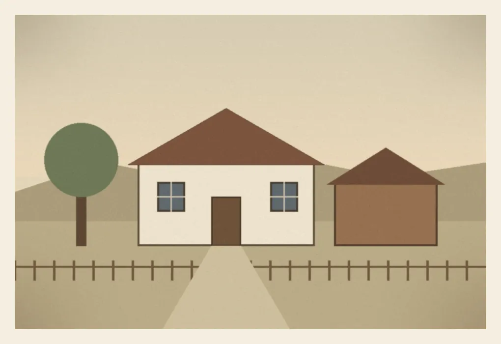

# Paměť rodu

Šablona **Rodové kroniky** pro vlastní genealogický výzkum.

Nástroj pro vlastní genealogický průzkum a rodinnou kroniku. Výsledkem je **jeden HTML soubor**, který se otevře v libovolném prohlížeči i bez internetu: rodokmen (vývod předků s čísly jako v knize i celý rodokmen), osoby, příběhy, mapa míst se stěhováním rodu, časová osa s dějinným kontextem, prameny s fotografiemi a ke každému údaji míra jistoty a pramen, ze kterého pochází. Ze stejných dat vznikne i tištěná kniha pro babičky a dědy a audiokniha.

Šablona obsahuje **vymyšlený ukázkový rod Kalinů z Lipové Lhoty** – nic z něj není skutečné. Můžeš si na něm vše vyzkoušet a pak začít vlastní kroniku.



## Nejrychlejší start: pošli odkaz AI asistentovi

Nainstaluj si [Claude Code](https://claude.com/claude-code) (nejpohodlněji desktopovou aplikaci Claude, záložka Code), otevři v ní libovolnou složku, kam chceš kroniku uložit (např. Dokumenty), a napiš:

> Chci si založit rodovou kroniku podle tohoto projektu: *odkaz na tento repozitář*

Asistent tě provede instalací, ukázkou i prvním rozhovorem o rodině. Bez AI asistenta postupuj podle oddílu [První spuštění](#první-spuštění-5-minut).

### Pokyny pro AI asistenta (Claude Code, Codex a další)

Pokud tě uživatel poslal na tento repozitář, aby si založil vlastní kroniku, postupuj takto. Mluv česky, krátce a srozumitelně – uživatel nemusí být programátor. Před každým krokem, který něco instaluje nebo mění mimo složku projektu, se zeptej.

1. **Kam:** zeptej se, kam projekt uložit (výchozí: podsložka `rodova-kronika` v aktuální složce). Naklonuj repozitář (`git clone <odkaz> rodova-kronika`); když git chybí, stáhni ZIP (`<odkaz>/archive/refs/heads/main.zip`) a rozbal ho.
2. **Odpojení od šablony:** v klonu spusť `git remote rename origin sablona`. Kronika bude obsahovat osobní údaje, takže se nikdy nesmí pushnout do veřejného repozitáře. Pokud uživatel chce zálohu na GitHubu, založ mu nový **soukromý** repozitář (`gh repo create <nazev> --private --source . --remote origin`) až po jeho výslovném souhlasu.
3. **Node.js:** ověř `node --version` (potřeba 20 nebo novější). Když chybí, vysvětli, jak ho nainstalovat z [nodejs.org](https://nodejs.org/) (verze LTS), nebo s jeho souhlasem nainstaluj (`winget install OpenJS.NodeJS.LTS` ve Windows, `brew install node` na macOS).
4. **Ukázka:** ve složce projektu spusť `node scripts/build.mjs` a `node --test`, otevři uživateli `dist/rodova-kronika.html` v prohlížeči a ve dvou třech větách mu ukaž rodokmen, osobu s rozporem (Jan Kalina), mapu a míru jistoty. Ukázkový rod je vymyšlený.
5. **Pravidla projektu:** přečti `AGENTS.md` a dovednosti v `.claude/skills/*/SKILL.md` – platí pro veškerou další práci. Řekni uživateli, že pro další práci je nejlepší otevřít v Claude Code přímo složku projektu (pak se pravidla a dovednosti načtou samy).
6. **Vlastní kronika:** až bude uživatel chtít, postupuj podle dovednosti `.claude/skills/prvni-spusteni/SKILL.md` a pak `uvodni-rozhovor`: založ kroniku přes `node scripts/init.mjs --vlastni --jmeno "…"`, vyptej se, co o rodině ví, zapiš to a navrhni další kroky výzkumu.

## Co potřebuješ

- **Node.js 20 nebo novější** (zdarma, [nodejs.org](https://nodejs.org/), na Windows stačí stáhnout instalátor „LTS“ a klikat Další). Nic dalšího se neinstaluje – projekt nemá žádné npm závislosti.
- Volitelně **Git**, pokud chceš mít historii změn a zálohu.
- Volitelně pro rozhovory s pamětníky: **ffmpeg** (převod zvuku) a **Python 3.10+** s knihovnou faster-whisper (automatický přepis). Viz [Rozhovory](#rozhovory-s-pametniky).
- Volitelně pro audioknihu: Windows s českým hlasem (Nastavení › Čas a jazyk › Řeč).

## První spuštění (5 minut)

1. Stáhni projekt (zelené tlačítko **Code › Download ZIP** na GitHubu, nebo `git clone`) a rozbal ho.
2. Otevři v té složce příkazový řádek (ve Windows: v Průzkumníku do adresního řádku napiš `cmd` a Enter).
3. Zkus ukázku:

   ```bash
   node scripts/build.mjs
   ```

   a otevři `dist/rodova-kronika.html` dvojklikem. To je hotová kronika.
4. Až budeš chtít začít vlastní kroniku:

   ```bash
   node scripts/init.mjs
   ```

   Skript se zeptá na tvé jméno, rok narození a název kroniky a založí prázdný rodokmen s tebou jako výchozí osobou. Ukázka zůstane ve složce `examples/ukazka/` (vrátíš ji příkazem `node scripts/init.mjs --ukazka --force`).
5. Po každé změně dat znovu spusť `node scripts/build.mjs` a obnov stránku v prohlížeči.

Kontrola, že vše funguje: `node --test` (spustí všechny testy).

## Jak kronika roste

Všechna data jsou v jednom souboru `src/data/genealogy.json`: osoby, vztahy, události, místa, prameny, média, tvrzení s mírou jistoty, badatelské úkoly a historie změn. Přesný popis polí je v [docs/data-contract.md](docs/data-contract.md).

Nejpohodlnější je pracovat s AI asistentem (Claude Code, Codex apod.): projekt obsahuje pokyny [AGENTS.md](AGENTS.md) a připravené dovednosti ve složce `.claude/skills/`:

| Dovednost | K čemu |
|---|---|
| `prvni-spusteni` | Provede instalací, ukázkou a založením vlastní kroniky. |
| `uvodni-rozhovor` | Asistent se tě vyptá, co o rodině víš, a založí první osoby, úkoly a seznam podkladů. |
| `novy-nalez` | Zapíše nález z matriky, dokumentu nebo vyprávění správně do dat (pramen, přepis, tvrzení, stav důkazu); umí použít dávku změn. |
| `vydani-a-sdileni` | Sestaví vydání pro rodinu, zašifruje je, připraví dotazník, archivní vydání a zpracuje došlé návrhy. |
| `zpracuj-rozhovor` | Projde přepis nahraného rozhovoru a navrhne vzpomínky, úryvky a nová tvrzení. |
| `kontrola-soukromi` | Před sdílením zkontroluje, že se ven nedostanou údaje žijících lidí nebo pracovní poznámky. |

Bez AI asistenta stačí textový editor (např. VS Code): zkopíruj podobný záznam z ukázky a uprav ho. Chybu v datech ohlásí `node --test`.

### Míra jistoty

Každé důležité tvrzení má jeden ze čtyř stavů a nejméně jeden pramen:

- **Ověřeno** (`verified`) – doloženo vlastním primárním zápisem (matrika, úřední dokument).
- **Podpořeno** (`supported`) – podporují ho nezávislé, ale slabší prameny (sčítání, náhrobek, index).
- **Rodinný záznam** (`family-record`) – vyprávění, rodinný sešit, dopis.
- **Hypotéza / rozpor** (`hypothesis`) – pracovní domněnka nebo nevyřešený rozpor.

Rozpory se nemažou, zapisují se vedle sebe. Jak hodnotit prameny, popisuje [docs/genealogicky-vyzkum-postupy.md](docs/genealogicky-vyzkum-postupy.md).

## Kde začít s výzkumem

[docs/pruvodce-vyzkumem.md](docs/pruvodce-vyzkumem.md) provede prvními týdny: co sesbírat doma, jak vést rozhovor s pamětníky ([dotazník](docs/dotaznik-pro-pametniky.md) a [souhlas s nahráváním](docs/souhlas-s-nahravanim.md)), jak číst digitalizované matriky a jak bezpečně používat MyHeritage a FamilySearch jako pracovní stopy.

## Tři vydání kroniky

Ze stejných dat se sestaví tři podoby:

| Příkaz | Soubor | Pro koho |
|---|---|---|
| `node scripts/build.mjs` | `dist/rodova-kronika.html` | **Rodinné vydání** – pro příbuzné: bez badatelských úkolů, historie změn a pracovních poznámek; míra jistoty a prameny zůstávají. |
| `node scripts/build.mjs --edition research` | `dist/rodova-kronika-badatel.html` | **Badatelské vydání** – jen pro tebe: všechna data a navíc **Badatelna** (níže). Nikdy ho nesdílej. |
| `node scripts/build.mjs --edition light` | `dist/rodova-kronika-lehka.html` | **Lehké vydání** – rodinné vydání bez nahrávek a s menšími obrázky, pro e-mail a slabší telefony. |

Rodinné vydání ukazuje i „Co je nového“ od posledního archivního vydání (viz níže). Texty pro rodinu doladíš v `src/data/family-edition.json`.

## Badatelna

V badatelském vydání je v menu **Badatelna** s pracovními nástroji. Nic z nich se neukládá přímo do dat: změny se sbírají do **dávky změn**, kterou si stáhneš a vložíš příkazem (viz níže).

- **Výzkumná fronta** – seřazený seznam otevřených otázek (chybějící rodič, sňatek, úmrtí, slabá vazba) s odhadem přínosu a s matrikami z tvého katalogu (`src/data/registers.json`), ve kterých má smysl hledat. Pod ní tvé ruční badatelské úkoly.
- **Zdraví dat** – kontrola věrohodnosti: věk rodičů při narození dítěte, narození po smrti rodiče, sňatek v dětském věku, možné duplicity, „ověřeno“ bez primárního pramene, vazby bez důkazu, údaje jen z pracovních stop, nepoužité prameny, místa bez souřadnic. Nález, který je ve skutečnosti v pořádku, potvrdíš jako výjimku (`research/accepted-findings.json`).
- **Přepis zápisu** – formulář pro matriční zápis (narození, sňatek, úmrtí): opíšeš řádek podle předlohy, propojíš osoby s kronikou (nebo založíš nové) a vznikne pramen, události, vazby a tvrzení najednou.
- **Editor** – úprava osob, vztahů, událostí, tvrzení, pramenů a míst přímo v aplikaci. U fotografie v detailu pramene označíš tváře a řádky se jménem („Kdo to je?“).
- **DNA** – volitelně, pokud máš výsledky DNA testů v `research/dna.json`: odhad příbuzenství podle sdílených cM a shluky shod podle větví. Shody jsou žijící lidé – zapisuj je jen pod přezdívkou.

## Dávky změn

Úpravy z Badatelny, návrhy od příbuzných i import GEDCOM vznikají jako soubor `*.json` ve formátu „dávka změn“. Do dat se dostanou až po tvé kontrole:

```bash
node scripts/apply-changes.mjs zmeny.json --dry-run
node scripts/apply-changes.mjs zmeny.json
```

Skript vypíše každou změnu, zkontroluje odkazy, schéma i věrohodnost (nová závažná chyba zápis zastaví), teprve potom soubory zapíše, zvýší verzi a přidá záznam do historie změn.

## Spolupráce s rodinou

- **Návrhy oprav a vzpomínek**: vyplň `meta.feedback.email` a kronika u osob, míst a fotek nabídne formulář, který připraví e-mail. Došlé e-maily ulož jako text a převeď na dávku změn: `node scripts/import-suggestions.mjs zprava1.txt zprava2.eml` (původní znění se uloží do `research/suggestions/`). Pak `apply-changes`.
- **Dotazník na papír** pro příbuzného bez počítače – co o něm, jeho rodičích a prarodičích kronika neví, s místem na odpovědi: `node scripts/questionnaire.mjs --person <id> --pdf`.
- **GEDCOM 7** pro výměnu s jinými programy a servery (MyHeritage, FamilySearch, Gramps):

  ```bash
  node scripts/gedcom.mjs export --living private
  node scripts/gedcom.mjs import cizi-rodokmen.ged
  ```

  Export skryje údaje žijících osob. Import nic nezapisuje: vytvoří kandidáty se shodami proti tvým osobám a dávku změn (vše se stavem „hypotéza“ a poznámkou, že údaj vyžaduje ověření).

## Sdílení s rodinou

Podrobně v [docs/soukromi-a-sdileni.md](docs/soukromi-a-sdileni.md). Stručně:

- **Zaheslovaná kronika** pro počítač a telefon:

  ```bash
  node scripts/build.mjs
  node scripts/protect.mjs
  ```

  Vznikne `dist/rodova-kronika-zaheslovana.html`. Soubor se šifruje v počítači (AES-GCM), heslo předej rodině zvlášť. Bez hesla nejde otevřít ani obnovit. Lehké vydání zašifruješ `node scripts/protect.mjs --input dist/rodova-kronika-lehka.html --output dist/rodova-kronika-lehka-zaheslovana.html`.
- **Tištěná kniha**: `node scripts/build-book.mjs --pdf` (PDF vytiskne nainstalovaný Edge nebo Chrome; `--ego id-osoby` = kniha z pohledu jiné osoby; `--ego id-manžela --partner id-manželky` = kniha předků manželského páru, např. jako svatební nebo výroční dar).
- **Audiokniha**: `node scripts/build-audiobook.mjs` (Windows, český hlas; bez hlasu vzniknou jen texty; `--partner` funguje stejně jako u knihy).
- **Kronika na webu zdarma (GitHub Pages)** – zaheslovaná kronika na vlastní adrese, kterou rodina otevře v telefonu bez stahování:

  ```bash
  node scripts/publish-pages.mjs --target ../rodokmen-web --commit
  ```

  Skript sestaví rodinné vydání, zašifruje ho (heslo aspoň **16 znaků** – stránku si může stáhnout kdokoli a hesla zkoušet), ověří, že jde heslem otevřít, a do složky `../rodokmen-web` zapíše jen `index.html` se šifrovanou stránkou, `robots.txt` (bez indexování vyhledávači), `.nojekyll`, krátké README a s `--domain moje-domena.cz` soubor `CNAME`. Všechno zkontroluje proti tvým datům (jména, ID, místa, e-maily); jiný soubor ve složce běh zastaví. Pak jednou založ na GitHubu **samostatný** repozitář (např. `rodokmen-web`), propoj ho (`git -C ../rodokmen-web remote add origin <adresa>`), zapni v jeho nastavení Pages (větev `main`) a příště stačí `--push`. Tvůj rodinný repozitář s daty zůstává soukromý; veřejný je jen zašifrovaný soubor. Starší verze stránky zůstávají v historii toho repozitáře – při změně hesla je bezpečnější repozitář založit znovu.
- **Archivní vydání** jednou za čas (třeba k Vánocům): `node scripts/release.mjs` vytvoří ve `releases/<verze>/` datovanou sadu na dlouhá léta – kroniku, knihu v PDF, GEDCOM, data, návod `CTI-ME.txt` a kontrolní součty – a lokální git tag `vydani-<verze>`. Od něj počítá „Co je nového“ v dalším rodinném vydání.

## Rozhovory s pamětníky

1. Zvuk z videí nebo diktafonu: `node scripts/import-interview.mjs 2026-11-02-jmeno-pametnika video1.mp4 video2.mp4` (potřebuje ffmpeg).
2. Do složky `assets/interviews/<id>/` můžeš dát `prompt.txt` se jmény, obcemi a slovy z rozhovoru – přepis je pak píše správně.
3. Přepis běží lokálně, nic se neodesílá:

   ```bash
   python -m venv .venv-whisper
   .venv-whisper/Scripts/python -m pip install faster-whisper
   .venv-whisper/Scripts/python scripts/transcribe.py assets/interviews/2026-11-02-jmeno-pametnika
   ```

   (Na Linuxu a macOS `.venv-whisper/bin/python`. S grafikou NVIDIA doinstaluj `nvidia-cublas-cu12 "nvidia-cudnn-cu12==9.*"`; bez ní přepis běží pomaleji na procesoru. Model má asi 3 GB.)
4. Úryvky zapiš do dat jako média `kind: "audio-clip"` a vyřízni je `node scripts/make-clips.mjs`.

Plné nahrávky se do gitu neukládají (`.gitignore`) – zálohuj je zvlášť.

## Soukromí na prvním místě

- Svůj rodinný repozitář **nech soukromý**. `src/data/`, `assets/` a `dist/` obsahují osobní údaje.
- Nezaheslovaný `dist/rodova-kronika.html` nedávej na sdílená úložiště.
- U žijících lidí zapisuj jen to, s čím souhlasí (často stačí jméno a rok narození).
- Aplikace nic neodesílá na internet; mapa i knihovny jsou vložené přímo do souboru.

## Aktualizace šablony

Nové funkce se do šablony přenášejí z autorovy soukromé kroniky skriptem, který kopíruje jen kód a hlídá, aby se do veřejného projektu nedostala žádná rodinná data – postup je v [docs/prenos-funkci.md](docs/prenos-funkci.md). Pokud máš vlastní kopii šablony v gitu, nové verze si stáhneš `git pull` z původního repozitáře; tvoje data v `src/data/` se nepřepíšou, kromě vzácných změn ukázky (pak ponech svou verzi).

## Struktura projektu

```text
src/                 aplikace (JavaScript, styly, šablona HTML) a vendored knihovny
src/data/            tvoje data: genealogy.json (hlavní soubor) a doplňkové soubory níže
examples/ukazka/     vymyšlený ukázkový rod se všemi soubory (používají ho testy)
schema/              JSON Schema dat; build podle něj kontroluje chyby
assets/              fotografie (source = pracovní kopie, optimized = náhledy WebP) a rozhovory
research/            jen soukromé: DNA, došlé návrhy, importy, výřezy matrik (nepovinné)
scripts/             build, vydání, kniha, audiokniha, zaheslování, dávky změn, GEDCOM, rozhovory, init
tools/               nástroj pro výřezy z digitalizovaných matrik MZA (mza-crop.js)
tests/               automatické testy (node --test) a vizuální testy (node scripts/visual-test.mjs)
docs/                datový kontrakt, průvodce výzkumem, dotazník, soukromí
.claude/skills/      dovednosti pro AI asistenta
```

Doplňkové soubory dat v `src/data/` (všechny nepovinné, podrobně v [docs/data-contract.md](docs/data-contract.md)):

| Soubor | Co obsahuje |
|---|---|
| `family-edition.json` | texty a vynechávky pro rodinné vydání |
| `gazetteer.json` | historický místopis: dřívější a německé názvy obcí, farnost, panství, okres |
| `history-local.json` | dějiny tvých obcí; ukážou se u lidí, kteří tam žili |
| `registers.json` | katalog matrik (archiv, signatura, farnost, roky) pro výzkumnou frontu |
| `media-notes.json` | datace fotografií a označené tváře a nápisy |
| `history.json` | obecné dějiny s důrazem na Moravu; můžeš ho rozšířit nebo použít jiný (`--history`) |

## Licence

Kód šablony: viz [LICENSE](LICENSE). Vendored knihovny mají vlastní licence ve `src/vendor/` (Leaflet BSD-2-Clause, Leaflet.markercluster MIT, ELK.js EPL-2.0); obrysy států pocházejí z Natural Earth (public domain). Tvoje data a fotografie patří tobě a licence šablony se na ně nevztahuje.
